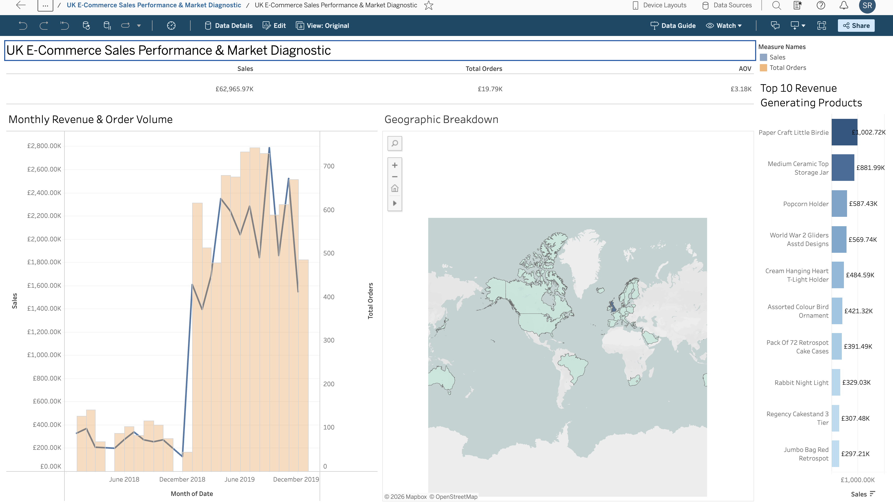

# UK E-Commerce Sales Performance & Market Diagnostic

## 📌 Executive Overview
An interactive executive BI dashboard analyzing 500,000+ transactional records from a UK-based online retail platform. The solution provides strategic visibility into macro revenue trajectories, seasonal demand surges, product concentration, and international market penetration.

---

## Live Dashboard

 **Interactive Version:** [View the Live Tableau Dashboard Here](https://prod-uk-a.online.tableau.com/#/site/rvshreevarthini-e63d2f1690/workbooks/3787489?:origin=card_share_link))

---

## Key Business Findings
* **Macro Performance:** Net gross revenue reached **£62.97M** across **19.8K completed transactions**, demonstrating severe demand concentration in Q4.
* **Product Concentration (Pareto Principle):** Sales are heavily driven by top-performing home and novelty SKUs, with the top item (*Paper Craft Little Birdie*) generating over **£1.0M** in revenue alone.
* **Geographic Expansion & Unit Economics:** Domestic UK sales represent the primary volume (>85%), while select international markets (e.g., Germany, France) yield higher Average Order Value (AOV), highlighting clear targets for overseas marketing spend.

---

## 🛠️ Technical Implementation
* **Platform:** Tableau Desktop / Tableau Public, macOS
* **Data Engineering & Cleaning:** Handled zero/negative cancellations, addressed null customer IDs with `IFNULL` string fallback to retain guest revenues, and enforced strict data typing.
* **Calculated Fields:**
  * `Sales = [Quantity] * [Price]`
  * `Total Orders = COUNTD([TransactionNo])`
  * `AOV = SUM([Sales]) / [Total Orders]`
* **Visual Structure:** Metric KPI strip, dual-axis continuous monthly trend (Revenue vs. Transaction Volume), Top-10 horizontal bar chart, and choropleth geographic mapping with cross-filtering actions.
