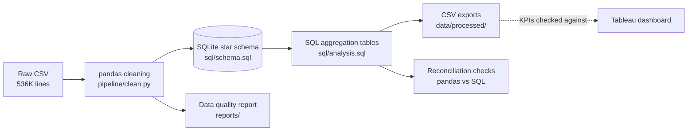
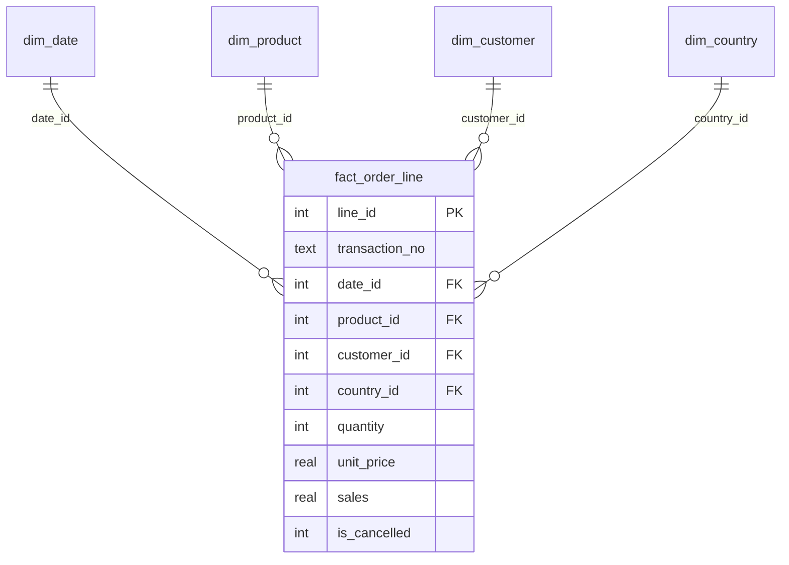

# UK E-Commerce Sales Performance & Market Diagnostic

[](https://prod-uk-a.online.tableau.com/#/site/rvshreevarthini-e63d2f1690/workbooks/3787489?:origin=card_share_link)
[](https://github.com/Shreevarthini/UK-ecommerce-sales-diagnostic/actions/workflows/tests.yml)

## Executive Overview

An interactive executive BI dashboard analysing 536K transaction lines (1 Dec 2018 to 9 Dec 2019) from a UK-based online retail platform, backed by a reproducible Python and SQL data pipeline. The solution gives visibility into revenue trends, seasonal demand, product concentration and international market mix.

https://www.kaggle.com/datasets/gabrielramos87/an-online-shop-business

**What is in this repository**

- A Tableau dashboard (screenshot and live link below).
- A pandas cleaning step that counts every data-quality issue it finds.
- A relational star schema in SQLite, with keys, constraints and indexes.
- SQL aggregation tables using CTEs and window functions, exported as CSVs.
- Reconciliation checks that compare the SQL totals with pandas, plus 14 pytest tests that run in CI.

---

## Live Dashboard

[](dashboard_preview.png)

**Interactive version:** [View the live Tableau dashboard](https://prod-uk-a.online.tableau.com/#/site/rvshreevarthini-e63d2f1690/workbooks/3787489?:origin=card_share_link)

---

## Key Business Findings

All figures below come from the SQL output in `data/processed/` and reconcile to the dashboard.

- **Macro performance:** Completed-order revenue (cancellations excluded) reached **£62.97M** across **19,790 transactions** (1 Dec 2018 to 9 Dec 2019; December 2019 is a partial month). Cancelled lines were worth about £2.69M; netting them off gives £60.28M.
- **Seasonality:** Revenue ramps up from September (£6.6M) and peaks in November (£7.9M), about 1.8x the Dec 2018 to Aug 2019 monthly average of £4.3M. October and November alone account for 24% of the total.
- **Product concentration:** Moderate rather than extreme. The top 20% of products generate 74% of revenue, and about 25% of the 3,753 products generate 80%. The top item, *Paper Craft Little Birdie*, earns **£1.0M** but is only 1.6% of revenue.
- **Geography and unit economics:** The UK is **83% of revenue** and about 90% of orders. Germany and France have a modestly higher average order value (AOV) than the UK (£3,028 and £3,294 vs £2,933). The Netherlands (£22.9K) and EIRE (£6.2K) are far higher, but the Netherlands figure comes from only 94 orders.
- **Order size:** AOV across all markets is about £3,180 per transaction, which suggests a large share of trade or wholesale customers rather than individual consumers.

---

## Data Pipeline (Python, pandas, SQL)



### Relational model



Grain: one row per transaction line. Keys, `CHECK` constraints and indexes are defined in [`sql/schema.sql`](sql/schema.sql).

### Data quality report

The cleaning rules and what they found in this dataset (full report in [`reports/data_quality_report.md`](reports/data_quality_report.md)):

| Issue | Treatment | Found |
|---|---|---|
| Exact duplicate lines | Counted and reported. Kept when run with `--keep-duplicates` (matches the dashboard), removed otherwise | 5,200 |
| Unparseable dates | Removed | 0 |
| Non-numeric price or quantity | Removed | 0 |
| Zero or negative price | Removed (stock adjustments, not sales) | 0 |
| Missing customer ID | Kept and labelled `GUEST`, so guest revenue is retained | 55 |
| Cancellations (`C` prefix or negative quantity) | Flagged with `is_cancelled`, excluded from revenue | 8,585 lines |

### Reconciliation

Run with `--keep-duplicates`; every check passes (pandas total equals SQL total).

| Stage | Value |
|---|---|
| Raw lines | 536,350 |
| Exact duplicate lines found | 5,200 (kept) |
| Cancelled lines | 8,585 |
| Completed lines | 527,765 |
| Completed transactions | 19,790 |
| Completed revenue | £62,965,974.34 (matches the dashboard) |
| Completed revenue if duplicates are removed | £62,781,386.54 |

The raw data has no line ID, so identical lines can be genuine repeat scans or double entries. The difference is £184.6K (0.3% of revenue), so both figures are reported rather than guessing.

### SQL aggregation tables

Defined in [`sql/analysis.sql`](sql/analysis.sql) and exported to `data/processed/`.

| Table | Technique |
|---|---|
| `kpi_summary` | Headline revenue, completed transactions, AOV, units |
| `monthly_revenue` | CTE, `LAG` for month-on-month growth, running total with `SUM() OVER` |
| `product_pareto` | CTE, `RANK`, share and cumulative revenue share |
| `customer_segments` | CTE, `NTILE(4)` revenue quartiles (guests excluded) |
| `country_summary` | CTE, AOV, revenue share, `RANK` |
| `cancellation_by_month` | Conditional `COUNT(DISTINCT ...)` |

### Tests and CI

14 pytest tests run on every push through GitHub Actions. They use a small hand-calculated dataset, so no large file is needed. They cover:

- each cleaning rule and its counts
- foreign-key integrity and fact row counts
- hand-checked SQL results (monthly growth, Pareto, country AOV, segments, cancellation rate)
- reconciliation between pandas and SQL

### Run it

```bash
pip install -r requirements.txt
# place the raw CSV at data/raw/sales_transactions.csv (not committed)
python run_pipeline.py --raw data/raw/sales_transactions.csv --keep-duplicates
python -m pytest -v
```

Expected columns in the raw file: `TransactionNo, Date, ProductNo, ProductName, Price, Quantity, CustomerNo, Country`.

### Repository structure

```
├── pipeline/          clean.py, warehouse.py, runner.py
├── sql/               schema.sql, analysis.sql
├── tests/             test_pipeline.py
├── data/processed/    aggregate CSVs produced by the pipeline
├── reports/           data quality report
├── run_pipeline.py    command-line entry point
└── dashboard_preview.png
```

---

## Technical Implementation

- **Dashboard:** Tableau Desktop / Tableau Public (macOS).
- **Data cleaning in Tableau:** Handled zero and negative cancellations, filled null customer IDs with an `IFNULL` string fallback to retain guest revenue, and enforced strict data typing.
- **Calculated fields:**
  - `Sales = [Quantity] * [Price]`
  - `Total Orders = COUNTD([TransactionNo])`
  - `AOV = SUM([Sales]) / [Total Orders]`
- **Visual structure:** KPI strip, dual-axis monthly trend (revenue vs transaction volume), top-10 horizontal bar chart, and a choropleth map with cross-filtering actions.
- **Pipeline:** Python 3, pandas, SQLite. The schema and queries are standard SQL and would run on PostgreSQL with minor type changes.

## Limitations

- The Tableau dashboard uses its own data source. The pipeline reproduces and checks its KPIs but does not feed it.
- The pipeline is a batch job over a static historical file, not a streaming or incremental load.
- December 2019 is a partial month (data ends 9 December), so its month-on-month change is not meaningful.
- AOV is per transaction, so it should not be read as spend per consumer.
- SQLite is used for portability and is not intended as a production database.